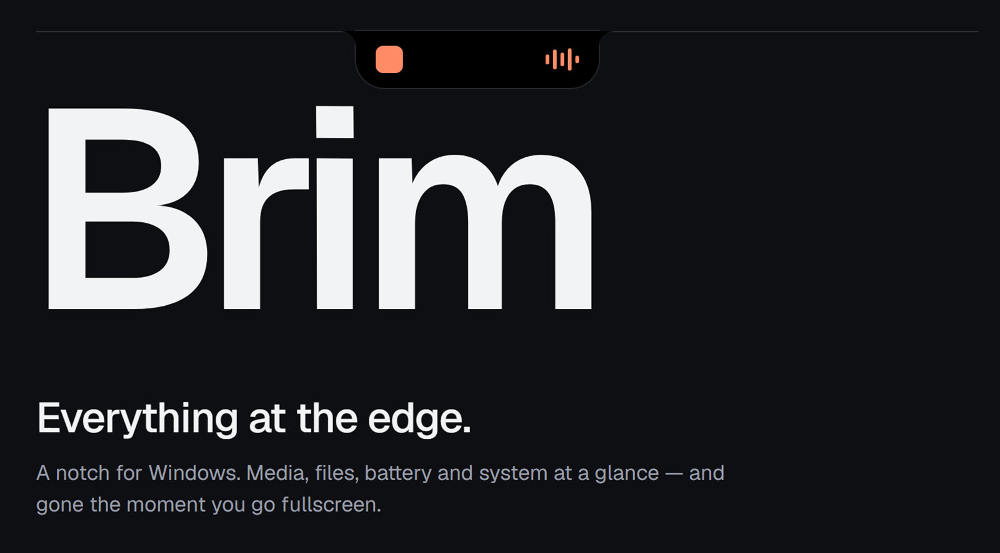
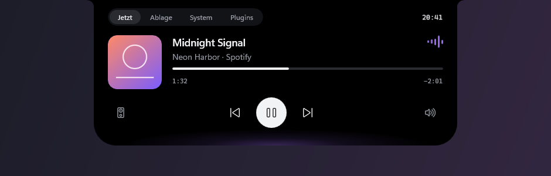
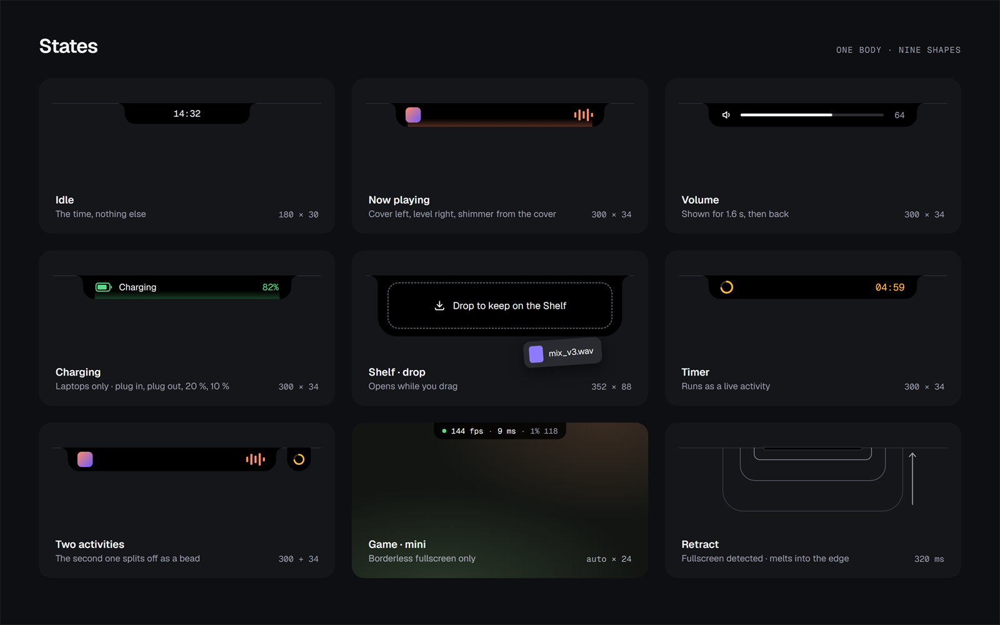
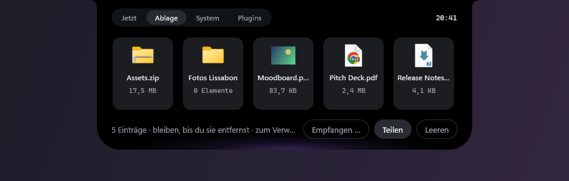
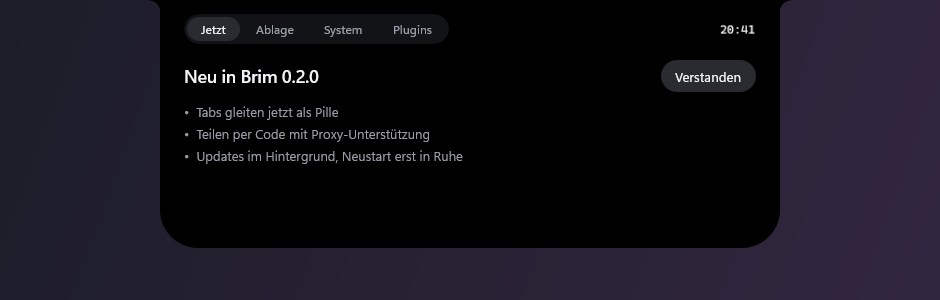

<p align="center">
  
</p>

<p align="center">
  <b>Eine Notch für Windows.</b> Musik, Dateien, Teilen und System auf einen Blick —<br>
  und weg, sobald ein Fenster den Platz braucht.
</p>

<p align="center">
  <a href="https://github.com/wheatley2056/brim/releases/latest"></a>
  <a href="https://github.com/wheatley2056/brim/actions/workflows/release.yml"></a>
  
  
  <a href="LICENSE"></a>
</p>

<p align="center">
  <a href="https://github.com/wheatley2056/brim/releases/latest/download/BrimNotch-win-Setup.exe"><b>⬇ Für Windows herunterladen</b></a>
  &nbsp;·&nbsp;
  <a href="#funktionen">Funktionen</a>
  &nbsp;·&nbsp;
  <a href="#selbst-bauen">Selbst bauen</a>
  &nbsp;·&nbsp;
  <a href="README.md">English</a>
</p>

---

Brim setzt eine lebendige Notch an den oberen Bildschirmrand – so, wie sich die Dynamic Island auf dem Handy anfühlt, aber nativ für Windows und nur mit offiziellen Schnittstellen. Sie bleibt klein, solange nichts passiert, wächst, wenn etwas passiert, und macht Platz, sobald ein Fenster ihn braucht.

<p align="center">
  <br>
  <sub>Bildschirmfotos der echten App mit Beispielinhalten.</sub>
</p>

## Funktionen

### 🎵 Musik
Cover, Titel, Fortschritt und Steuerung für alles, was die Windows-Mediensteuerung nutzt – Spotify, Browser, Medienwiedergabe, Spiele. Der Lichtschein der Notch übernimmt die Farbe des Covers. Spulen durch Ziehen, Audioausgabe wechseln und die Lautstärke jeder App direkt in der Notch einstellen.

### ✨ Ein Körper, viele Formen
Jeder Zustand – Uhr, Musik, Lautstärke, Timer, Hinweise – ist dieselbe Form, die sich mit echter Federphysik verwandelt (Response und Dämpfung wie in SwiftUI), gezeichnet vom Compositor mit der Bildwiederholrate deines Monitors: 60, 144 oder 240 Hz. Mit der Maus darauf schwillt sie an, bleibst du, öffnet sie sich aus dieser Bewegung heraus. Die Uhr gleitet in die Kopfzeile, statt zu springen.

<p align="center">
  <br>
  <sub>Leerlauf · Musik · zwei Aktivitäten – die zweite löst sich als Perle ab.</sub>
</p>

### 📁 Ablage
Dateien oder Ordner auf die Notch ziehen – sie bleiben, bis du sie entfernst, auch nach einem Neustart. Herausziehen in den Explorer, in Mails, Discord oder einen Browser-Upload. Dateien aus flüchtigen Orten (Downloads, Anhänge) werden kopiert, damit sie nicht verschwinden; fehlende werden markiert statt versteckt.

<p align="center">
  
</p>

### 📡 Teilen – in der Nähe und überall
- **In der Nähe:** Andere Brims im Netzwerk erscheinen von selbst (DNS-SD). Dateien gehen direkt, verschlüsselt mit gegenseitigem TLS und geprüften Zertifikats-Fingerabdrücken. Nichts kommt ohne deine Zustimmung an.
- **Überall, per Code:** An jeden mit einem kurzen Code wie `7-guitarist-revenge`. Brim spricht das offene Protokoll von [Magic Wormhole](https://magic-wormhole.readthedocs.io) – die Gegenseite kann Brim sein oder `wormhole receive`, Warp, Winden und Co. Ende-zu-Ende-verschlüsselt (SPAKE2), funktioniert hinter NAT über ein Relay und durch HTTP- oder SOCKS5-Proxys.
- **Windows-Teilen** für Mail, Teams und andere Apps bleibt einen Klick entfernt.

### 🫥 Macht Platz
Liegt ein Fenster unter der Notch – maximiert, im Vollbild oder einfach hochgeschoben –, schmilzt Brim in die Kante. Auch beim Ziehen eines Fensters zur Snap-Leiste zieht sie sich zurück. Maus an die Oberkante, und sie kommt wieder herunter.

### 🔄 Updates, die du nicht merkst
Brim aktualisiert sich im Hintergrund aus den GitHub-Releases, lädt nur, was sich geändert hat, und startet erst neu, wenn du ein paar Minuten nicht am Rechner bist. Danach erzählt die Notch, was neu ist.

<p align="center">
  
</p>

### ♿ Für alle gebaut
Namen für die Windows-Bedienungshilfen überall, Ansagen der Sprachausgabe für HUDs, Tastatur mit <kbd>Win</kbd>+<kbd>Alt</kbd>+<kbd>N</kbd> und sanftes Überblenden statt Bewegung, wenn die Animationseffekte von Windows aus sind.

## Installieren

1. **[BrimNotch-win-Setup.exe](https://github.com/wheatley2056/brim/releases/latest/download/BrimNotch-win-Setup.exe)** aus der neuesten Version herunterladen.
2. Starten. Brim installiert sich nur für deinen Benutzer (keine Adminrechte), startet sofort und mit Windows.

> [!NOTE]
> Der Installer ist noch nicht signiert, deshalb kann Windows SmartScreen *„Der Computer wurde durch Windows geschützt“* melden. **Weitere Informationen → Trotzdem ausführen** klicken. Signieren steht auf der Roadmap.

**Voraussetzungen:** Windows 10 22H2 oder Windows 11, x64. Alles andere ist dabei.

**Bedienung**

| | |
|---|---|
| Maus auf die Notch | Sie schwillt an, dann öffnet sie sich |
| <kbd>Win</kbd>+<kbd>Alt</kbd>+<kbd>N</kbd> | Per Tastatur auf- und zuklappen |
| Datei auf die Notch ziehen | In der Ablage behalten |
| Maus an die Oberkante | Versteckte Notch zurückholen |
| Symbol im Infobereich | Einstellungsdatei, Protokolle, Beenden |

Einstellungen stehen in `%LocalAppData%\Brim\settings.json` (Animation, Ausblende-Regeln, Proxy, Updates).

## Datenschutz und Sicherheit

- **Keine Telemetrie, keine Konten, keine Brim-Server.** Brim geht nur ins Internet, um bei GitHub nach Updates zu sehen und – wenn du per Code sendest oder empfängst – zu den öffentlichen Magic-Wormhole-Servern, die ausschließlich verschlüsselte Daten sehen.
- **Teilen in der Nähe** nutzt gegenseitiges TLS mit Zertifikaten pro Installation; der im Netz angekündigte Fingerabdruck muss zur Verbindung passen.
- **Eingehende Dateien** brauchen immer deine Zustimmung; Pfade werden bereinigt, Archive gegen Pfad-Ausbrüche und ZIP-Bomben geprüft.
- Eine bewusste Ausnahme von „nur offizielle Schnittstellen“: Das Standard-Audiogerät wird über die undokumentierte Schnittstelle `IPolicyConfig` umgeschaltet (wie bei EarTrumpet und SoundSwitch), weil Windows dafür keine öffentliche anbietet.

## Selbst bauen

Braucht das [.NET 10 SDK](https://dotnet.microsoft.com/download), kein Visual Studio.

```bash
git clone https://github.com/wheatley2056/brim.git
cd brim
dotnet build Brim.slnx
dotnet run --project src/Brim
```

```bash
dotnet test Brim.slnx
```

Netz- und Kompatibilitätstests gegen das Original-Magic-Wormhole laufen, wenn `BRIM_WORMHOLE_CLI` auf eine `wormhole.exe` zeigt (`pip install magic-wormhole`).

**Bildschirmfotos:** `pwsh build/screenshots/make.ps1` erzeugt die Bilder in `docs/assets` neu aus der echten App im Vorführmodus (`BRIM_DEMO`: Beispiel-Song und -Dateien, eigener Datenordner, kein Netz).

**Release:** In [`CHANGELOG.md`](CHANGELOG.md) einen Abschnitt `## <Version>` anlegen, dann einen Tag `v<Version>` pushen. GitHub Actions baut, packt mit [Velopack](https://velopack.io) (inklusive Delta-Updates) und veröffentlicht; installierte Brims holen sich das Update selbst.

<details>
<summary><b>Aufbau</b></summary>

| Projekt | Inhalt |
|---|---|
| `src/Brim.Core` | Aktivitäten und Hub, Zustandsmaschine der Notch, deklarative Widgets, Geometrie, Federphysik, Ablage, Einstellungen. Ohne Windows-Abhängigkeit, vollständig getestet. |
| `src/Brim.Modules` | Eingebaute Module – Uhr, Musik, Audio, Teilen (LAN und Magic Wormhole), Updates. Sie beschreiben ihre Oberfläche als Widgets, kein WinUI. |
| `src/Brim` | Die WinUI-3-Shell: ein Fenster pro Monitor, Morph-Engine im Compositor, Widget-Renderer, Ablage, Ausblenden, Tray und Updater. |
| `tests/` | Zustandsmaschine, Federn, Geometrie, Ablage, Teilen-Protokoll, SPAKE2-Testvektoren aus der Referenz, Live-Gegenproben mit dem Original-Magic-Wormhole. |

Eingebaute Funktionen sind Module mit derselben Schnittstelle, die Plugins bekommen: Sie melden Aktivitäten mit Priorität und beschreiben ihre Oberfläche als Daten – die Shell entscheidet, was gezeigt wird. Der vollständige Entwurf steht in [`plan.md`](plan.md).
</details>

## Roadmap

- [x] **Fundament** – Notch, Uhr, Musik, Lautstärke, Feder-Morph, mehrere Monitore
- [x] **Ablage** – hineinziehen, behalten, herausziehen
- [x] **Teilen** – in der Nähe (LAN) und per Code (Magic Wormhole), mit Proxy
- [x] **Unbemerkte Updates** mit Changelog in der Notch
- [ ] **Ausblenden** – Regeln pro App, Bildschirmfreigabe erkennen *(Überlappung und Oberkante sind fertig)*
- [ ] **System** – Akku, CPU, RAM, GPU, Netzwerk, Helligkeit, Kamera/Mikrofon
- [ ] **Plugins** – offenes Protokoll und SDK für eigene Inhalte
- [ ] **Spiele** – FPS und Latenz als Mini-Pille
- [ ] **Mehr** – Timer, Kalender, Benachrichtigungen, Bluetooth-Akku, Einstellungsfenster, Signatur, winget

## Danke

Gebaut mit [Windows App SDK / WinUI 3](https://github.com/microsoft/WindowsAppSDK), [Windows Community Toolkit](https://github.com/CommunityToolkit/Windows), [WinUIEx](https://github.com/dotMorten/WinUIEx), [H.NotifyIcon](https://github.com/HavenDV/H.NotifyIcon), [NAudio](https://github.com/naudio/NAudio), [Win2D](https://github.com/microsoft/Win2D), [libsodium](https://libsodium.org), [CsWin32](https://github.com/microsoft/CsWin32) und [Velopack](https://velopack.io). Teilen per Code setzt das [Magic-Wormhole](https://github.com/magic-wormhole/magic-wormhole)-Protokoll von Brian Warner und Mitwirkenden um.

## Lizenz

Brim ist freie Software unter der [GNU General Public License v3.0](LICENSE).
